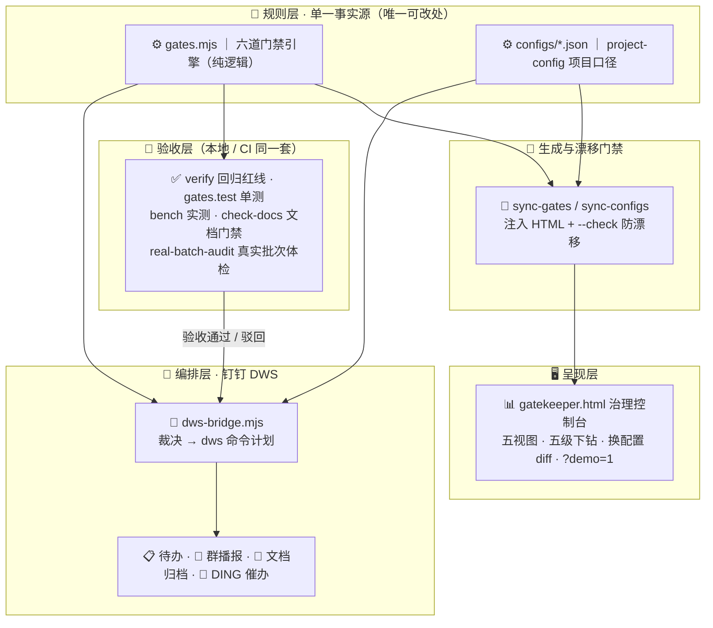

# GateKeeper
[](https://github.com/1273984347/GateKeeper/actions/workflows/gatekeeper.yml)

<picture>
  <source media="(prefers-color-scheme: dark)" srcset="assets/brand/lockup-dark.svg">
  
</picture>
> 创建日期：2026-08-31
> 来源：AI 产出治理项目自审（自我深度审查）
> Session：会话 ID 见 git 提交记录

> **一句话**：让 AI 批量产出的文档，规模再大也管得住、查得清、放得行。
> **当前版本**：v0.21.5
> 版本与计数的**唯一权威**见 [CHANGELOG.md](CHANGELOG.md) 顶部；本文件不内嵌会漂移的数字，用引用式表述。

## 这是什么

把企业里"AI 生成内容/文档之后的质量验收"从人肉抽查，变成一套可配置的**六道门禁**自动化流水线，并接进钉钉真实办公面（DWS）：验收通过自动归档文档、群播报、建审批待办、DING 催办；命中 P0 严重问题则条件分支驳回并 @ 责任人。换团队/换行业/换文档类型，改一份 project-config 即可，不改代码。

## 架构（三层，单一事实源）



文件级明细：

```
gates.mjs        六道门禁引擎（纯逻辑，前后端共用的唯一规则源）
 ├─ gatekeeper.html   可视化治理控制台：引擎块由 sync-gates 注入、配置/批次数据块由 sync-configs 注入（均勿手改），五视图/下钻/diff 在渲染层
 ├─ sync-gates.mjs    单一事实源生成器（规则）+ `--check` 漂移门禁
 ├─ sync-configs.mjs  单一事实源生成器（配置/数据）：把 configs/*.json 注入 HTML + `--check` 第二道漂移门禁
 ├─ verify.mjs        回归红线 + 换配置差异统一验收（本地 / CI 共用）
 └─ dws-bridge.mjs    编排：裁决 → dws 命令计划（--live 由 Agent 直接调用才落地）
      ├─ configs/*.json          声明式 project-config（版本注册表/引用/指标/渠道开关/字段映射）+ batches.sample.json 批次数据
      ├─ config.dws.json         目标 ID 占位符：群 / 复核人 / 作者 / 审批人 openDingTalkId（真实值本地填入，勿提交）
      └─ output/                 运行产物（本地生成，已 gitignore 不入库）：accept-*.md 验收报告 · gate-report.json · dws-plan.sh · bench-report.md
```

## 快速开始

### 60 秒本地跑通（不接钉钉）

钉钉/DWS 是**可选编排层**——核心门禁引擎、CLI 工具与治理控制台零外部依赖，纯本地即可跑通：

```bash
git clone https://github.com/1273984347/GateKeeper.git
cd GateKeeper/prototype
node verify.mjs                                                  # 回归红线：12 项断言全绿（样例五裁决基线）
node tools/gate.mjs                                              # 十三门全量门禁串行（约 10 秒，无 Playwright 时浏览器门自动 SKIP）
node project-check.mjs --config configs/gatekeeper-self.json ../README.md   # 用治理口径体检任意 markdown 文档
```

浏览器直接打开 `gatekeeper.html`（可加 `?demo=1` 进离线演示模式）——五视图 · 五级下钻 · 换配置 diff，单文件零外部依赖。`dws-bridge.mjs` 不填钉钉 ID 也正常运行（dry-run 出计划不执行），接真实钉钉才需要填 `config.dws.json`（见 [prototype/README-DWS.md](prototype/README-DWS.md)）。

### 环境要求

> **Node.js ≥ 20**（与 CI 同版本，零第三方依赖）。可选：`npm i -g playwright && npx playwright install chromium` 后启用布局门禁（门禁链第十三门）与前端冒烟，未安装时这两项自动 SKIP 不阻断。

### 常用命令

```bash
cd prototype
node sync-gates.mjs        # 改完 gates.mjs 后跑：把引擎逻辑重新注入 HTML（--check 可作提交前门禁）
node sync-configs.mjs      # 改完 configs/*.json 后跑：把配置/批次数据注入 HTML（--check 作第二道漂移门禁）
node sync-render.mjs       # 改完 render-core.mjs 后跑：把渲染纯函数注入 HTML（--check 作第三道漂移门禁）
node verify.mjs            # 回归红线 + 换配置差异：环50/6P0/9P1/8P2/1可发布 + G4 抑制，全绿 exit 0
node --test gates.test.mjs # 引擎单元/负样本测试（20 例：门禁行为/配置合并/畸形配置/正则防线/五裁决冗余）
node dws-bridge.mjs        # dry-run：打印将执行的真实 dws 命令 + 生成 output/dws-plan.sh
node bench.mjs             # 省时实测：召回/误报/耗时 → output/bench-report.md
node real-batch-audit.mjs --config audit-configs/xiyouji.json --glob "<真实文档目录>/**/*.md"  # 真实批次体检（--config 与 --glob/文件列表必填）→ output/real-batch-*.md
node check-docs.mjs        # 提交前门禁：全部核心文档 self-config 体检，任一非「可发布」exit 1
node tools/gate.mjs        # ↑全量门禁一键串行+汇总（--full 追加 bench/dry-run）；node tools/smoke.mjs 跑前端冒烟七项
# 打开 gatekeeper.html 看治理控制台（总览/明细/编排/配置对照/趋势 五视图 + 五级下钻）；加 ?demo=1 进离线演示模式
# --live 真实落地须由千问办公 Agent 直接调用 dws（见 README-DWS.md）
```

## 文档索引

| 文档 | 作用 |
|---|---|
| [DESIGN.md](DESIGN.md) | 设计方案：目标原则 / 三层架构 / 门禁契约 / 视觉系统 / 数据模型 / 取舍 |
| [ROADMAP.md](ROADMAP.md) | 后续发展与迭代路线图：短中长期 / 指标演进 / 决策闸门 |
| [CHANGELOG.md](CHANGELOG.md) | 正向时间线，每条含「来源/执行/文件/验证/状态」四件套 |
| [STRUCTURE.md](STRUCTURE.md) | 目录结构与命名/单一事实源/归档约定 |
| [配置切换Demo.md](配置切换Demo.md) | 同一引擎换三套配置体检三类项目——"改配置不改代码"的可执行实证 |
| [prototype/README-DWS.md](prototype/README-DWS.md) | DWS 接入指南与执行模型 |
| [prototype/人工实测对照表.md](prototype/人工实测对照表.md) | 人工审核耗时对照实测表（含 human-baseline 采集器使用说明） |

## 核心指标（引用式，权威值见 CHANGELOG / bench-report）

六道门禁（G1 引用溯源 · G2 版本一致 · G3 格式 · G4 广告法 · G5 敏感信息 · G6 证据链）；对 20 条埋 15 处违规的样例批次，流水线**召回 100%、零误报、扫描毫秒级**；对 216 篇真实文档批次体检 173 可发布(80%)、218 真实缺口、506 文学误报经配置抑制；已在真实钉钉组织跑通待办/群消息/文档归档/DING 四类 DWS 动作。实测数字由 `node bench.mjs` 本地生成（`prototype/output/bench-report.md`，运行产物不入库）。

## 授权与免责

本项目以 [Apache License 2.0](LICENSE) 开源。样例与演示数据均为脱敏模拟，不含真实个人信息或商业秘密。广告合规门禁为辅助审核，不替代法务正式审批。
